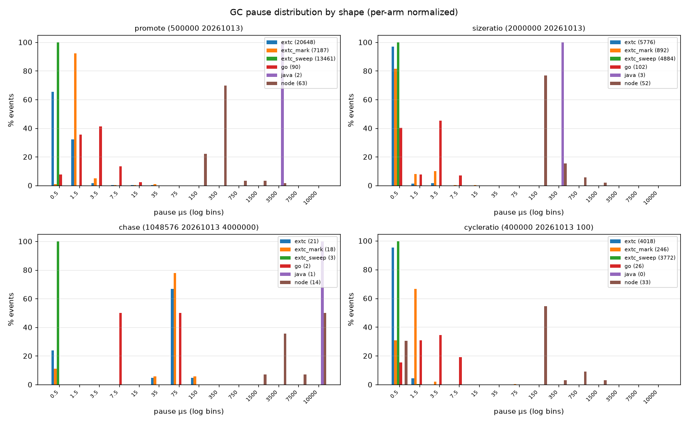

# 跨语言停顿分布（v2）

回答的问题：同一形状下，各语言的 GC 停顿**事件有多长、分布是什么形状**——不只报 max。

口径：每个臂报的是**它自己运行期承认的停顿事件**，定义逐臂不同，读表前先看下面这栏。
能对齐的是形状、分位、超阈占比、事件频度与占墙钟比例；绝对时长跨定义比较要谨慎。
Rust / C++ 手工释放，没有 GC 停顿，不进本表。

| 臂 | 事件来源（meta.source） |
|---|---|
| extc | EXTC_RC_SLOWSTEP=0.001 -> [slow] dur_us= lines (per bounded step: mark / sweep) |
| extc_mark | EXTC_RC_SLOWSTEP=0.001 -> [slow] lines with kind=mark |
| extc_sweep | EXTC_RC_SLOWSTEP=0.001 -> [slow] lines with kind=sweep |
| go | GODEBUG=gctrace=1 stderr 'gc N ... A+B+C ms clock' -> A (sweep termination STW) + C (mark termination STW), *1000 = us |
| java | -Xlog:gc:file=<tmp> ' Pause ' lines; trailing <N>ms field -> us (per STW GC pause event) |
| node | node --trace-gc-nvp -> per-GC 'pause' field (ms) x1000 to us; V8 STW pause of Scavenge/Mark-Compact/Mark-Sweep |
## 读法（先看这六条，再看数）

1. **事件数不可直接比**：extC 每条有界回收步算一个事件（上万条），Go 每个 GC 周期两段、Java 每条 GC 暂停、Node 每次 GC 各算一个（个位数到两位数）。
   频率差异是「细粒度增量 vs 整轮 STW」的口径差，不是谁更忙。
2. **样本量与分辨率**：Java 0–3 条、Go 2–102 条 ⇒ 它们的 p99/max 基本是单点噪声；Node 的 `pause` 只有 1 位小数 ms（100 µs 分辨率），
   亚 100 µs 的 scavenge 记成 0 ⇒ `[0,100)` 那些细档别读；三个托管语言都是新进程、无预热。
3. **extC 的「停顿」是在 mutator 线程上做的 GC 工作**（没有独立 GC 线程）⇒ 它的 `total_us` 与 `total_gc_us` 同值（见下一节）；
   拿它的 p50 去和 Go 的 STW p50 排名次是错的，要比的是「mutator 被占住多少时间」= 下一节的 Σ 表。
4. **max 是抢占敏感量**：extC chase 的最长一步是 0.10 ms（`over1ms=0`，没有事件跨过 1 ms），分位与超阈计数比 max 更值得看；
   仓库纪律是用超阈计数与分位（`≥1ms` 列、p99/p99.9）而不是 max。
5. **取数必须串行**：所有臂都钉同一条核（见 `pause/README.md` 第 2 节），并发跑会互相抢占（同一臂两次数值可差数倍）。
6. **占比高不是缺陷，占比低也不等于便宜**：停顿/GC 占比是「这次运行里回收付出了多少」；判「值不值」要配同一形状的**峰值 RSS**（见 `REPORT.md` 的墙钟/RSS 表）。
   extC 占比高（`promote` 18.6%、`cycleratio` 9.5%）换来的是 7.2–7.5 MB 峰值；Java 的 `cycleratio` 0 事件、0.0% 占比，代价是 **98.6 MB**（`promote` 的 2.5% 也是靠 111.0 MB 堆头寸）。
   低占比既可能是「回收便宜」，也可能是「还没回收」，两张表要一起读。

## 分形状

### promote（500000 20261013）

| 臂 | 事件数 | 事件/s | 总停顿 | 占墙钟 | p50 | p90 | p99 | p99.9 | max | ≥1ms |
|---|---|---|---|---|---|---|---|---|---|---|
| extc_sweep | 13461 | 146564 | 4.03 ms | 4.38% | 1.00 µs | 1.00 µs | 1.00 µs | 1.00 µs | 200.00 µs | 0 |
| extc | 20648 | 224816 | 17.12 ms | 18.64% | 0.40 µs | 1.40 µs | 3.20 µs | 34.68 µs | 116.40 µs | 0 |
| go | 90 | 676 | 256.00 µs | 0.19% | 3.00 µs | 5.00 µs | 10.55 µs | 14.56 µs | 15.00 µs | 0 |
| extc_mark | 7187 | 78252 | 13.09 ms | 14.25% | 2.00 µs | 2.00 µs | 50.00 µs | 100.00 µs | 200.00 µs | 0 |
| node | 63 | 499 | 17.30 ms | 13.71% | 200.00 µs | 400.00 µs | 1.67 ms | 2.06 ms | 2.10 ms | 3 |
| java | 2 | 9 | 5.41 ms | 2.52% | 2.71 ms | 2.87 ms | 2.90 ms | 2.91 ms | 2.91 ms | 2 |

### sizeratio（2000000 20261013）

| 臂 | 事件数 | 事件/s | 总停顿 | 占墙钟 | p50 | p90 | p99 | p99.9 | max | ≥1ms |
|---|---|---|---|---|---|---|---|---|---|---|
| extc_sweep | 4884 | 139547 | 1.47 ms | 4.20% | 1.00 µs | 1.00 µs | 1.00 µs | 2.00 µs | 100.00 µs | 0 |
| extc | 5776 | 165033 | 2.27 ms | 6.48% | 0.30 µs | 0.60 µs | 2.30 µs | 8.65 µs | 53.00 µs | 0 |
| extc_mark | 892 | 25486 | 800.40 µs | 2.29% | 1.00 µs | 5.00 µs | 5.00 µs | 50.00 µs | 50.00 µs | 0 |
| go | 102 | 2164 | 196.00 µs | 0.42% | 3.00 µs | 4.00 µs | 6.99 µs | 7.00 µs | 7.00 µs | 0 |
| java | 3 | 31 | 1.01 ms | 1.05% | 347.00 µs | 398.20 µs | 409.72 µs | 410.87 µs | 411.00 µs | 0 |
| node | 52 | 329 | 9.40 ms | 5.94% | 100.00 µs | 200.00 µs | 1.05 ms | 1.27 ms | 1.30 ms | 1 |

### chase（1048576 20261013 4000000）

| 臂 | 事件数 | 事件/s | 总停顿 | 占墙钟 | p50 | p90 | p99 | p99.9 | max | ≥1ms |
|---|---|---|---|---|---|---|---|---|---|---|
| extc_sweep | 3 | 19 | 0.10 µs | 0.00% | 1.00 µs | 1.00 µs | 1.00 µs | 1.00 µs | 1.00 µs | 0 |
| go | 2 | 12 | 66.00 µs | 0.04% | 33.00 µs | 52.20 µs | 56.52 µs | 56.95 µs | 57.00 µs | 0 |
| extc | 21 | 134 | 1.22 ms | 0.78% | 75.30 µs | 84.80 µs | 99.46 µs | 101.75 µs | 102.00 µs | 0 |
| extc_mark | 18 | 115 | 1.22 ms | 0.78% | 100.00 µs | 100.00 µs | 200.00 µs | 200.00 µs | 200.00 µs | 0 |
| java | 1 | 3 | 59.29 ms | 15.87% | 59.29 ms | 59.29 ms | 59.29 ms | 59.29 ms | 59.29 ms | 1 |
| node | 14 | 10 | 430.10 ms | 29.34% | 8.40 ms | 77.02 ms | 193.31 ms | 206.26 ms | 207.70 ms | 14 |

### cycleratio（400000 20261013 100）

| 臂 | 事件数 | 事件/s | 总停顿 | 占墙钟 | p50 | p90 | p99 | p99.9 | max | ≥1ms |
|---|---|---|---|---|---|---|---|---|---|---|
| java | 0 | 0 | 0.00 µs | 0.00% | 0.00 µs | 0.00 µs | 0.00 µs | 0.00 µs | 0.00 µs | 0 |
| extc_sweep | 3772 | 194835 | 1.47 ms | 7.58% | 1.00 µs | 1.00 µs | 1.00 µs | 5.00 µs | 50.00 µs | 0 |
| extc | 4018 | 207541 | 1.84 ms | 9.51% | 0.40 µs | 0.40 µs | 1.60 µs | 3.09 µs | 83.20 µs | 0 |
| extc_mark | 246 | 12707 | 373.70 µs | 1.93% | 2.00 µs | 2.00 µs | 5.00 µs | 100.00 µs | 100.00 µs | 0 |
| go | 26 | 695 | 73.00 µs | 0.19% | 3.00 µs | 6.00 µs | 8.25 µs | 8.93 µs | 9.00 µs | 0 |
| node | 33 | 450 | 5.10 ms | 6.95% | 100.00 µs | 460.00 µs | 1.04 ms | 1.18 ms | 1.20 ms | 1 |

## Sigma GC time (not the same quantity as the pause table above)

上表是停顿（各语言定义不同，见 README 第 0 节）；这里是该次运行里可观测到的全部 GC 时间
（口径见 README 第 1.2 节，- 表示该臂没提供）。extC 没有独立 GC 线程，它的停顿步就是全部 GC 工作；
Go/Java/Node 的并发阶段不计入停顿，但计入这里。

### promote（500000 20261013）

| 臂 | 停顿合计 | 停顿/墙钟 | GC 工作合计 | GC/墙钟 | 墙钟 |
|---|---|---|---|---|---|
| java | 5.41 ms | 2.52% | 5.41 ms | 2.52% | 215.0 ms |
| node | 17.30 ms | 13.71% | 16.71 ms | 13.24% | 126.2 ms |
| extc | 17.12 ms | 18.64% | 17.20 ms | 18.73% | 91.8 ms |
| go | 256.00 µs | 0.19% | 59.96 ms | 45.03% | 133.1 ms |

### sizeratio（2000000 20261013）

| 臂 | 停顿合计 | 停顿/墙钟 | GC 工作合计 | GC/墙钟 | 墙钟 |
|---|---|---|---|---|---|
| java | 1.01 ms | 1.05% | 1.01 ms | 1.05% | 96.1 ms |
| node | 9.40 ms | 5.94% | 9.33 ms | 5.90% | 158.3 ms |
| extc | 2.27 ms | 6.48% | 2.32 ms | 6.64% | 35.0 ms |
| go | 196.00 µs | 0.42% | 13.71 ms | 29.07% | 47.1 ms |

### chase（1048576 20261013 4000000）

| 臂 | 停顿合计 | 停顿/墙钟 | GC 工作合计 | GC/墙钟 | 墙钟 |
|---|---|---|---|---|---|
| extc | 1.22 ms | 0.78% | 1.22 ms | 0.78% | 156.3 ms |
| java | 59.29 ms | 15.87% | 59.29 ms | 15.87% | 373.5 ms |
| go | 66.00 µs | 0.04% | 30.07 ms | 18.02% | 166.9 ms |
| node | 430.10 ms | 29.34% | 429.60 ms | 29.31% | 1465.7 ms |

### cycleratio（400000 20261013 100）

| 臂 | 停顿合计 | 停顿/墙钟 | GC 工作合计 | GC/墙钟 | 墙钟 |
|---|---|---|---|---|---|
| java | 0.00 µs | 0.00% | 0.00 µs | 0.00% | 75.7 ms |
| node | 5.10 ms | 6.95% | 4.72 ms | 6.44% | 73.3 ms |
| extc | 1.84 ms | 9.51% | 1.77 ms | 9.17% | 19.4 ms |
| go | 73.00 µs | 0.19% | 10.30 ms | 27.52% | 37.4 ms |

## 图

每格 = 一个形状，横轴为停顿时长（对数），纵轴为该臂**事件占比**（%，同一臂内归一），
柱上标注事件总数。绝对值不可跨定义直读，看的应是「分布有多宽、尾巴有多长、事件有多少」。

