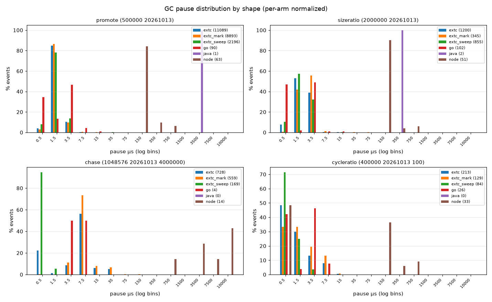

# 跨语言停顿分布（v2）

回答的问题：同一形状下，各语言的 GC 停顿**事件有多长、分布是什么形状**——不只报 max。

口径：每个臂报的是**它自己运行期承认的停顿事件**，定义逐臂不同，读表前先看下面这栏。
能对齐的是形状、分位、超阈占比、事件频度与占墙钟比例；绝对时长跨定义比较要谨慎。
Rust / C++ 手工释放，没有 GC 停顿，不进本表。

| 臂 | 事件来源（meta.source） |
|---|---|
| extc | EXTC_RC_SLOWSTEP=0.001 -> [slow] dur_us= lines (per bounded step: mark / sweep) |
| extc_mark | EXTC_RC_SLOWSTEP=0.001 -> [slow] lines with kind=mark |
| extc_sweep | EXTC_RC_SLOWSTEP=0.001 -> [slow] lines with kind=sweep |
| go | GODEBUG=gctrace=1 stderr 'gc N ... A+B+C ms clock' -> A (sweep termination STW) + C (mark termination STW), *1000 = us |
| java | -Xlog:gc:file=<tmp> ' Pause ' lines; trailing <N>ms field -> us (per STW GC pause event) |
| node | node --trace-gc-nvp -> per-GC 'pause' field (ms) x1000 to us; V8 STW pause of Scavenge/Mark-Compact/Mark-Sweep |
## 读法（先看这六条，再看数）

1. **事件数不可直接比**：extC 每条有界回收步算一个事件（上万条），Go 每个 GC 周期两段、Java 每条 GC 暂停、Node 每次 GC 各算一个（个位数到两位数）。
   频率差异是「细粒度增量 vs 整轮 STW」的口径差，不是谁更忙。
2. **样本量与分辨率**：Java 0–2 条、Go 4–102 条 ⇒ 它们的 p99/max 基本是单点噪声；Node 的 `pause` 只有 1 位小数 ms（100 µs 分辨率），
   亚 100 µs 的 scavenge 记成 0 ⇒ `[0,100)` 那些细档别读；三个托管语言都是新进程、无预热。
3. **extC 的「停顿」是在 mutator 线程上做的 GC 工作**（没有独立 GC 线程）⇒ 它的 `total_us` 与 `total_gc_us` 同值（见下一节）；
   拿它的 p50 去和 Go 的 STW p50 排名次是错的，要比的是「mutator 被占住多少时间」= 下一节的 Σ 表。
4. **max 是抢占敏感量**：extC chase 的最长一步是 0.07 ms（`over1ms=0`，没有事件跨过 1 ms），分位与超阈计数比 max 更值得看；
   仓库纪律是用超阈计数与分位（`≥1ms` 列、p99/p99.9）而不是 max。
5. **取数必须串行**：所有臂都钉同一条核（见 `pause/README.md` 第 2 节），并发跑会互相抢占（同一臂两次数值可差数倍）。
6. **占比高不是缺陷，占比低也不等于便宜**：停顿/GC 占比是「这次运行里回收付出了多少」；判「值不值」要配同一形状的**峰值 RSS**（见 `REPORT.md` 的墙钟/RSS 表）。
   extC 占比高（`promote` 40.5%、`cycleratio` 5.2%）换来的是 7.4–7.5 MB 峰值；Java 的 `cycleratio` 0 事件、0.0% 占比，代价是 **104.4 MB**（`promote` 的 1.3% 也是靠 127.6 MB 堆头寸）。
   低占比既可能是「回收便宜」，也可能是「还没回收」，两张表要一起读。

## 分形状

### promote（500000 20261013）

| 臂 | 事件数 | 事件/s | 总停顿 | 占墙钟 | p50 | p90 | p99 | p99.9 | max | ≥1ms |
|---|---|---|---|---|---|---|---|---|---|---|
| extc | 10671 | 265514 | 16.29 ms | 40.53% | 1.20 µs | 2.60 µs | 4.90 µs | 19.36 µs | 80.10 µs | 0 |
| extc_sweep | 1772 | 44091 | 3.24 ms | 8.06% | 5.00 µs | 5.00 µs | 5.00 µs | 10.00 µs | 20.00 µs | 0 |
| go | 90 | 799 | 181.00 µs | 0.16% | 3.00 µs | 4.00 µs | 7.55 µs | 11.56 µs | 12.00 µs | 0 |
| extc_mark | 8899 | 221423 | 13.05 ms | 32.47% | 2.00 µs | 2.00 µs | 10.00 µs | 50.00 µs | 100.00 µs | 0 |
| node | 63 | 566 | 9.40 ms | 8.44% | 100.00 µs | 200.00 µs | 738.00 µs | 793.80 µs | 800.00 µs | 0 |
| java | 1 | 5 | 2.38 ms | 1.27% | 2.38 ms | 2.38 ms | 2.38 ms | 2.38 ms | 2.38 ms | 1 |

### sizeratio（2000000 20261013）

| 臂 | 事件数 | 事件/s | 总停顿 | 占墙钟 | p50 | p90 | p99 | p99.9 | max | ≥1ms |
|---|---|---|---|---|---|---|---|---|---|---|
| extc | 1542 | 87271 | 2.21 ms | 12.51% | 1.70 µs | 2.10 µs | 2.40 µs | 10.08 µs | 65.90 µs | 0 |
| go | 102 | 2238 | 185.00 µs | 0.41% | 2.50 µs | 4.00 µs | 4.99 µs | 14.89 µs | 16.00 µs | 0 |
| extc_sweep | 1197 | 67746 | 1.46 ms | 8.26% | 2.00 µs | 5.00 µs | 5.00 µs | 10.00 µs | 10.00 µs | 0 |
| extc_mark | 345 | 19526 | 751.00 µs | 4.25% | 5.00 µs | 5.00 µs | 10.00 µs | 100.00 µs | 100.00 µs | 0 |
| java | 2 | 13 | 634.00 µs | 0.42% | 317.00 µs | 359.40 µs | 368.94 µs | 369.89 µs | 370.00 µs | 0 |
| node | 51 | 654 | 7.10 ms | 9.10% | 100.00 µs | 100.00 µs | 650.00 µs | 695.00 µs | 700.00 µs | 0 |

### chase（1048576 20261013 4000000）

| 臂 | 事件数 | 事件/s | 总停顿 | 占墙钟 | p50 | p90 | p99 | p99.9 | max | ≥1ms |
|---|---|---|---|---|---|---|---|---|---|---|
| java | 0 | 0 | 0.00 µs | 0.00% | 0.00 µs | 0.00 µs | 0.00 µs | 0.00 µs | 0.00 µs | 0 |
| extc_sweep | 74 | 506 | 18.10 µs | 0.01% | 1.00 µs | 1.00 µs | 1.00 µs | 1.00 µs | 1.00 µs | 0 |
| go | 4 | 26 | 17.00 µs | 0.01% | 4.50 µs | 5.70 µs | 5.97 µs | 6.00 µs | 6.00 µs | 0 |
| extc | 635 | 4341 | 5.54 ms | 3.79% | 5.70 µs | 11.86 µs | 41.73 µs | 58.13 µs | 74.80 µs | 0 |
| extc_mark | 561 | 3835 | 5.53 ms | 3.78% | 10.00 µs | 20.00 µs | 50.00 µs | 100.00 µs | 100.00 µs | 0 |
| node | 14 | 14 | 315.90 ms | 31.11% | 7.55 ms | 66.87 ms | 112.89 ms | 116.86 ms | 117.30 ms | 12 |

### cycleratio（400000 20261013 100）

| 臂 | 事件数 | 事件/s | 总停顿 | 占墙钟 | p50 | p90 | p99 | p99.9 | max | ≥1ms |
|---|---|---|---|---|---|---|---|---|---|---|
| java | 0 | 0 | 0.00 µs | 0.00% | 0.00 µs | 0.00 µs | 0.00 µs | 0.00 µs | 0.00 µs | 0 |
| extc_sweep | 210 | 12764 | 577.30 µs | 3.51% | 5.00 µs | 5.00 µs | 5.00 µs | 20.00 µs | 20.00 µs | 0 |
| go | 26 | 773 | 49.00 µs | 0.15% | 2.50 µs | 4.00 µs | 5.00 µs | 5.00 µs | 5.00 µs | 0 |
| extc | 339 | 20605 | 848.30 µs | 5.16% | 2.00 µs | 4.82 µs | 5.30 µs | 13.34 µs | 17.40 µs | 0 |
| extc_mark | 129 | 7841 | 271.00 µs | 1.65% | 2.00 µs | 10.00 µs | 10.00 µs | 10.00 µs | 10.00 µs | 0 |
| node | 33 | 572 | 3.70 ms | 6.42% | 100.00 µs | 360.00 µs | 736.00 µs | 793.60 µs | 800.00 µs | 0 |

## Sigma GC time (not the same quantity as the pause table above)

上表是停顿（各语言定义不同，见 README 第 0 节）；这里是该次运行里可观测到的全部 GC 时间
（口径见 README 第 1.2 节，- 表示该臂没提供）。extC 没有独立 GC 线程，它的停顿步就是全部 GC 工作；
Go/Java/Node 的并发阶段不计入停顿，但计入这里。

### promote（500000 20261013）

| 臂 | 停顿合计 | 停顿/墙钟 | GC 工作合计 | GC/墙钟 | 墙钟 |
|---|---|---|---|---|---|
| java | 2.38 ms | 1.27% | 2.38 ms | 1.27% | 187.7 ms |
| node | 9.40 ms | 8.44% | 8.79 ms | 7.89% | 111.4 ms |
| extc | 16.29 ms | 40.53% | 16.29 ms | 40.54% | 40.2 ms |
| go | 181.00 µs | 0.16% | 51.52 ms | 45.76% | 112.6 ms |

### sizeratio（2000000 20261013）

| 臂 | 停顿合计 | 停顿/墙钟 | GC 工作合计 | GC/墙钟 | 墙钟 |
|---|---|---|---|---|---|
| java | 634.00 µs | 0.42% | 634.00 µs | 0.42% | 151.1 ms |
| node | 7.10 ms | 9.10% | 5.64 ms | 7.23% | 78.0 ms |
| extc | 2.21 ms | 12.51% | 2.21 ms | 12.48% | 17.7 ms |
| go | 185.00 µs | 0.41% | 12.79 ms | 28.06% | 45.6 ms |

### chase（1048576 20261013 4000000）

| 臂 | 停顿合计 | 停顿/墙钟 | GC 工作合计 | GC/墙钟 | 墙钟 |
|---|---|---|---|---|---|
| java | 0.00 µs | 0.00% | 0.00 µs | 0.00% | 161.9 ms |
| extc | 5.54 ms | 3.79% | 5.54 ms | 3.79% | 146.3 ms |
| node | 315.90 ms | 31.11% | 315.35 ms | 31.06% | 1015.4 ms |
| go | 17.00 µs | 0.01% | 49.02 ms | 31.77% | 154.3 ms |

### cycleratio（400000 20261013 100）

| 臂 | 停顿合计 | 停顿/墙钟 | GC 工作合计 | GC/墙钟 | 墙钟 |
|---|---|---|---|---|---|
| java | 0.00 µs | 0.00% | 0.00 µs | 0.00% | 68.6 ms |
| extc | 848.30 µs | 5.16% | 847.60 µs | 5.15% | 16.5 ms |
| node | 3.70 ms | 6.42% | 3.74 ms | 6.49% | 57.6 ms |
| go | 49.00 µs | 0.15% | 9.15 ms | 27.19% | 33.6 ms |

## 图

每格 = 一个形状，横轴为停顿时长（对数），纵轴为该臂**事件占比**（%，同一臂内归一），
柱上标注事件总数。绝对值不可跨定义直读，看的应是「分布有多宽、尾巴有多长、事件有多少」。

